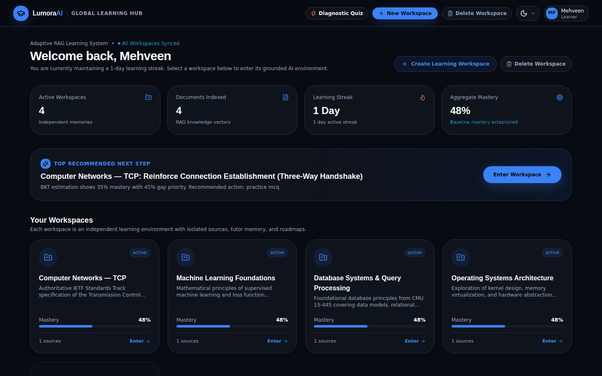
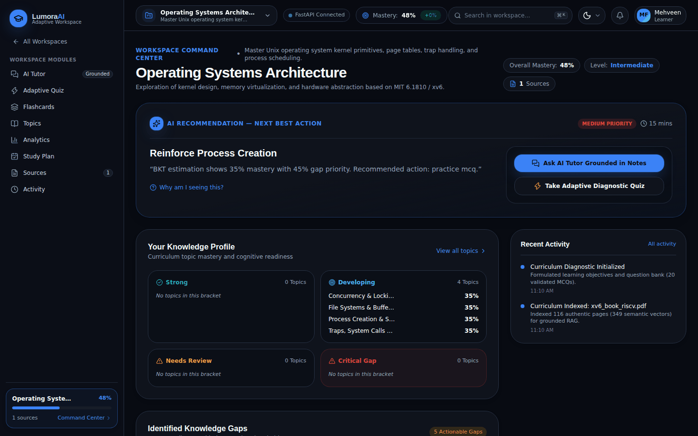
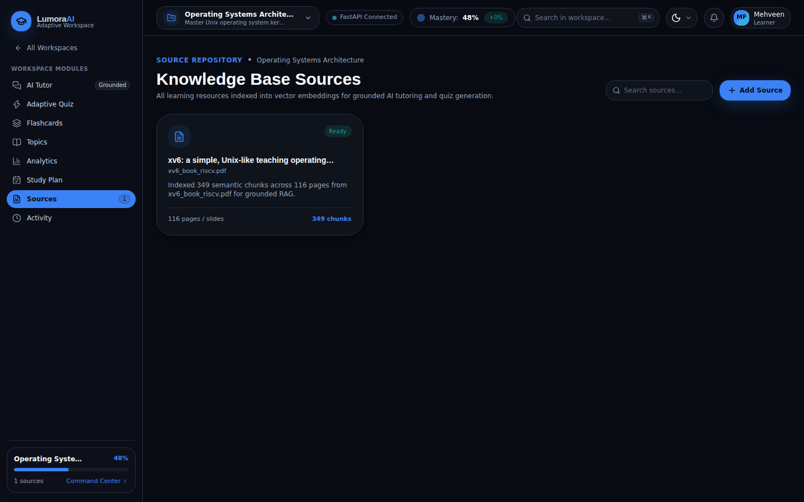
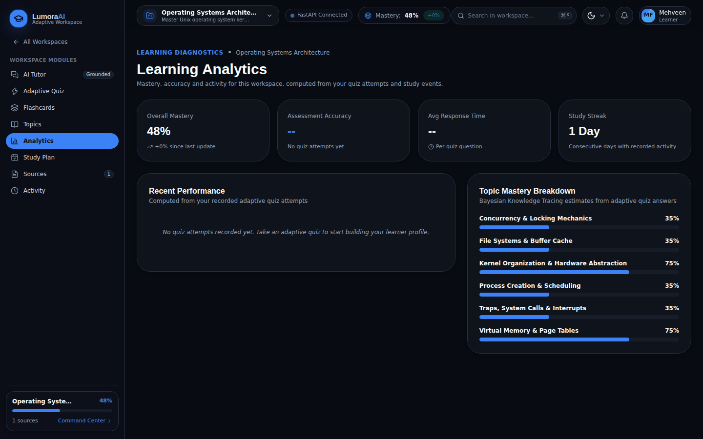
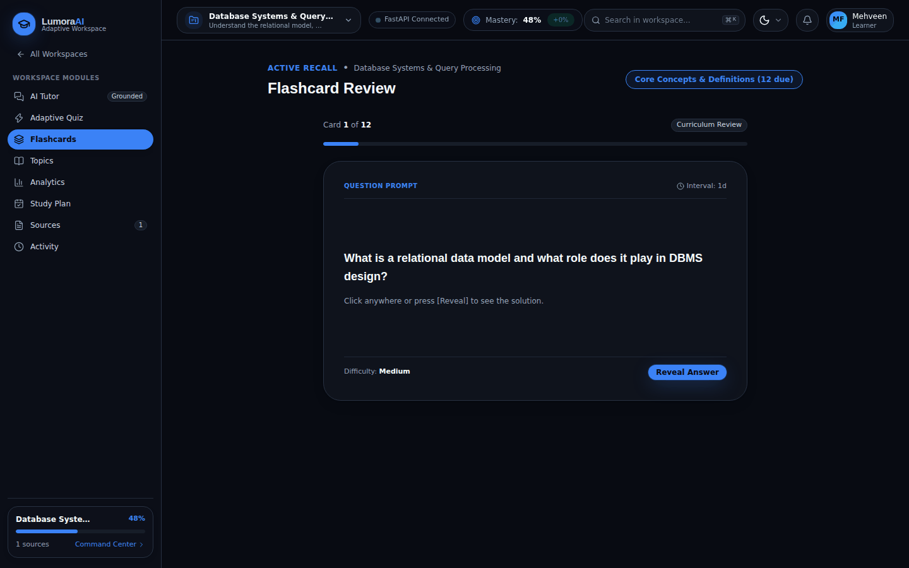
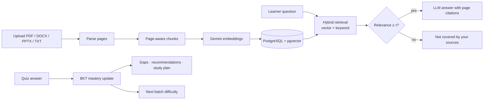

<div align="center">

# LumoraAI

**An adaptive learning platform that explains your own study material with cited answers and tracks what you know, concept by concept.**




</div>

## Overview

Students preparing for exams or placements collect slides, notes and textbooks from many places. Finding the passage that answers a doubt, and knowing which topics still need work, takes real effort. A general chatbot can answer from memory, but it can't point to your notes and doesn't know what you've already mastered.

LumoraAI combines two ideas:

- **Retrieval-augmented generation (RAG).** The AI tutor answers only from passages retrieved from the documents you upload and cites the document and page. When your sources don't cover a question, it says so instead of guessing.
- **Bayesian Knowledge Tracing (BKT).** Every quiz answer updates a mastery probability for that concept. Those estimates choose the difficulty of your next quiz batch, flag knowledge gaps and drive recommendations and the study plan.

Everything lives in **workspaces**, one per subject. Each workspace has its own documents, vector index, quiz history and mastery model.

## Features

| | |
| :--- | :--- |
| **Workspaces** | Separate subject workspaces with their own sources, conversations, quizzes and learner model. |
| **Document ingestion** | Upload PDF, DOCX, PPTX or TXT. Text is parsed page by page, split into page-aware chunks with heading metadata, embedded (768-d Gemini embeddings) and indexed with pgvector. |
| **Grounded AI tutor** | Hybrid vector and keyword retrieval with a relevance threshold, follow-up resolution ("why is this important?"), response modes (simplify, example, compare, summary, exam points, page focus) and page-level citations. |
| **Adaptive quiz** | Questions in batches of five. A batch score of 80% or more raises difficulty and adds new concepts, 60–80% consolidates, and below 60% lowers difficulty and revisits missed concepts. Answers are graded on the server. |
| **Question quality checks** | Generated MCQs must pass checks for structure, duplicates, option-length balance, answer leakage, citation leakage and raw code or table dumps before use. |
| **Learner model** | BKT mastery per concept, rolled up to topics, with knowledge gaps ranked by severity and a recommended next action. |
| **Study tools** | Flashcards generated from your sources, a study plan built from your gaps, learning analytics and an activity log. |
| **Resilient AI layer** | Gemini 3.8 Flash with automatic failover to Qwen via OpenRouter, rate-limit cooldowns, and an extractive source-only answer when no model is available. |

## Screenshots

| Workspace command center | Sources |
| :---: | :---: |
|  |  |
| **Learning analytics** | **Flashcards** |
|  |  |

<sub>Captured from a local run seeded with <code>scripts/reset_and_seed_real_workspaces.py</code>. Mastery values shown are that script's demo starting values, not earned results.</sub>

## How it works



The [architecture guide](docs/architecture.md) documents each stage with the parameters used in the code: retrieval scoring, the grounding threshold, the BKT equations and parameters, the adaptive-quiz bands, the question checks and the data model.

## Tech stack

| Layer | Technologies |
| :--- | :--- |
| Frontend | Next.js 16 (App Router), React 19, TypeScript, Tailwind CSS 4, Lucide icons |
| API proxy | Next.js route handler forwarding `/api/v1/*` to FastAPI |
| Backend | Python 3.11, FastAPI, Pydantic v2, asyncpg |
| Data | PostgreSQL with pgvector (HNSW cosine index), hosted on Supabase; Supabase Storage for original files |
| AI | Google Gemini 3.8 Flash and Gemini Embedding 001; Qwen3.8-27B via OpenRouter as fallback |
| Documents | PyMuPDF, python-docx, python-pptx |
| Testing | pytest, pytest-asyncio, httpx |

## Project structure

```
lumora-ai/
├── app/                       Next.js routes
│   ├── api/v1/[...path]/      Proxy to the FastAPI backend
│   ├── dashboard/             Workspace list and per-workspace pages
│   │   └── workspace/[workspaceId]/   tutor · quiz · flashcards · topics · analytics · study-plan · sources · activity
│   ├── login/ · register/     Auth screens (UI only, see Roadmap)
│   └── page.tsx               Landing page
├── components/                landing · workspace · auth · ui
├── lib/                       API client, service layer, domain types
├── backend/
│   ├── app/                   FastAPI app (routes, services, repositories, AI gateway, migrations)
│   ├── data/seed_pdfs/        Public course PDFs used by the seed script
│   └── tests/                 108 pytest tests
├── scripts/                   Seeding, verification and diagnostics (see scripts/README.md)
├── lumora_demo_content_pack/  Small sample PDFs for a demo workspace set
└── docs/                      Architecture guide and screenshots
```

## Getting started

### Prerequisites

- Node.js 20.9+ and npm
- Python 3.11+
- PostgreSQL with the `pgvector` extension (a free Supabase project works). This is optional for a quick look, because the API falls back to an in-memory store.
- A [Google AI Studio](https://aistudio.google.com/) API key, and optionally an [OpenRouter](https://openrouter.ai/) key for failover

### 1. Install

```bash
git clone https://github.com/MehveenFatima/lumora-ai.git
cd lumora-ai

npm install

python -m venv .venv
source .venv/bin/activate        # Windows: .venv\Scripts\activate
pip install -r backend/requirements.txt
```

### 2. Configure

```bash
cp .env.example .env
```

Fill in at least `GEMINI_API_KEY`, plus `DATABASE_URL` if you are using PostgreSQL. See [Environment variables](#environment-variables).

### 3. Create the database schema

Run the SQL files in [`backend/app/db/migrations/`](backend/app/db/migrations/README.md) in order, either in the Supabase SQL editor or with `psql`:

```bash
for f in backend/app/db/migrations/0*.sql; do psql "$DATABASE_URL" -v ON_ERROR_STOP=1 -f "$f"; done
```

### 4. Run

```bash
npm run dev:all          # FastAPI on :8000 and Next.js on :3000
```

You can also start them separately with `npm run backend` and `npm run dev`. Open <http://localhost:3000>. The interactive API docs are at <http://localhost:8000/docs>.

### 5. (Optional) Load sample workspaces

```bash
python scripts/reset_and_seed_real_workspaces.py
```

> **Warning:** this resets the database. It then seeds four workspaces from public course material: the MIT xv6 book, CMU 15-445 notes, Stanford CS229 notes and IETF RFC 9293. See [`scripts/README.md`](scripts/README.md) for what it writes.

## Environment variables

| Variable | Used by | Description |
| :--- | :--- | :--- |
| `BACKEND_API_URL` | Next.js | FastAPI base URL for the `/api/v1` proxy (default `http://127.0.0.1:8000`) |
| `GEMINI_API_KEY` | API | Google Gemini key for generation and embeddings |
| `GEMINI_MODEL` | API | Generation model (`models/gemini-3.8-flash`) |
| `GEMINI_EMBEDDING_MODEL` | API | Embedding model (`models/gemini-embedding-001`, 768 dimensions) |
| `OPENROUTER_API_KEY` | API | Key for the failover provider |
| `SECONDARY_AI_MODEL` | API | Failover model (default `qwen/qwen3.8-27b:free`) |
| `DATABASE_URL` | API | PostgreSQL connection string. Leave empty to use the in-memory store. |
| `SUPABASE_URL`, `SUPABASE_SERVICE_ROLE_KEY`, `SUPABASE_STORAGE_BUCKET` | API | Optional Supabase Storage for original files (otherwise stored under `backend/data/documents/`) |
| `RAG_TOP_K` | API | Passages retrieved per answer (default 5) |
| `FRONTEND_ORIGIN` | API | Additional allowed CORS origin |
| `ENVIRONMENT` | API | `development` or `production` |

The full template is [`.env.example`](.env.example). Never commit a real `.env`.

## API

The FastAPI backend exposes 34 endpoints under `/api/v1`:

- workspaces
- documents (upload, list, view, download, delete)
- tutor
- quizzes (session, attempt, next batch, complete, history)
- mastery and learner profile
- flashcards
- study plan
- activity

They are listed in the [backend README](backend/README.md), and OpenAPI docs are served at `/docs` when the server is running.

## Testing

```bash
python -m pytest backend/tests -q    # 108 backend tests; no database or API keys needed
npm run typecheck                    # TypeScript type check
```

The backend tests cover chunking, parsing, embeddings, retrieval and grounding, workspace isolation, the tutor's response modes and fallbacks, BKT, the adaptive quiz, question quality and leakage checks, and provider health. To run them against PostgreSQL, set `DATABASE_URL` to a **disposable** database with the migrations applied.

## Roadmap

These are known gaps in the current version:

- Authentication and multi-user support (Supabase Auth with row-level security). The auth screens are UI only and the API uses one default learner.
- Background ingestion with batched embeddings, and marking chunks embedded by the offline fallback
- LLM-generated question banks for the sample workspaces (the seed script currently uses a template generator)
- Persisted flashcard review scheduling and notifications
- A mastery-over-time chart built on the stored mastery snapshots
- A controlled study with learners to measure learning outcomes

## License

No license has been chosen yet, so all rights are reserved by the author. Please open an issue to ask about reuse.
