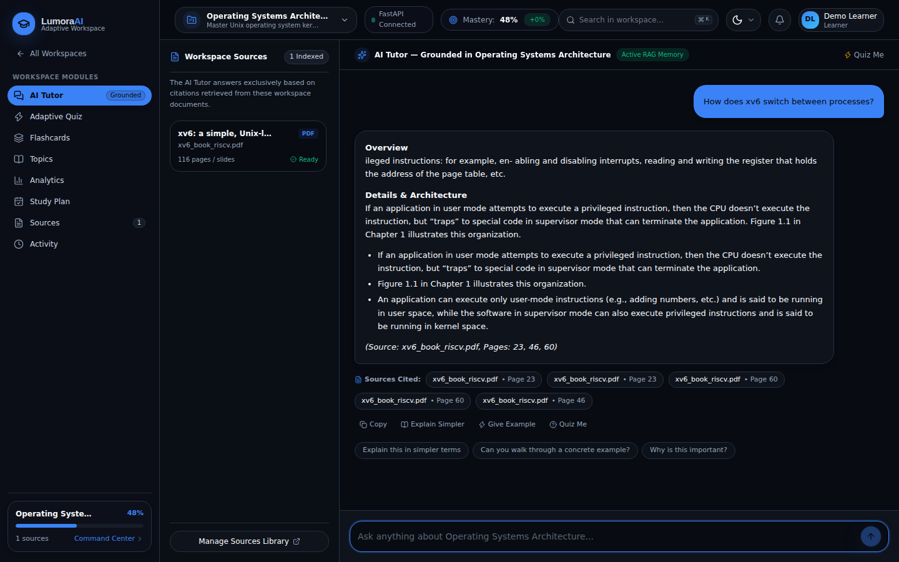
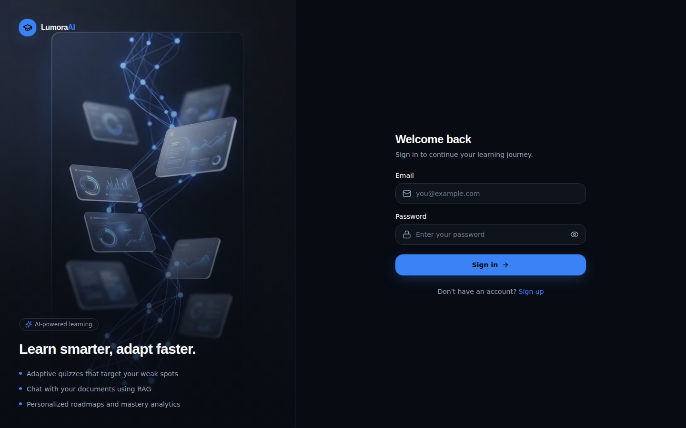
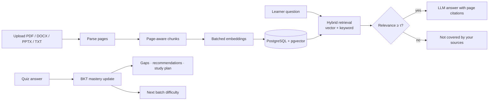

<div align="center">

# LumoraAI

**An adaptive learning platform that explains your own study material with cited answers and tracks what you know, concept by concept.**


</div>

## Overview

Students preparing for exams or placements collect slides, notes and textbooks from many places. Finding the passage that answers a doubt, and knowing which topics still need work, takes real effort. A general chatbot can answer from memory, but it can't point to your notes and doesn't know what you've already mastered.

LumoraAI combines two ideas:

- **Retrieval-augmented generation (RAG).** The AI tutor answers only from passages retrieved from the documents you upload and cites the document and page. When your sources don't cover a question, it says so instead of guessing.
- **Bayesian Knowledge Tracing (BKT).** Every quiz answer updates a mastery probability for that concept. Those estimates choose the difficulty of your next quiz batch, flag knowledge gaps and drive recommendations and the study plan.

Each user has their own account and **workspaces**, one per subject. Every workspace has its own documents, vector index, quiz history, flashcards and mastery model, and no user can see another user's data.

## Features

| | |
| :--- | :--- |
| **Accounts** | Email and password sign-up and sign-in, httpOnly session cookies, rate-limited login, and per-user data isolation enforced on every API route. |
| **Document ingestion** | Upload PDF, DOCX, PPTX or TXT. Files are validated, parsed page by page, split into page-aware chunks with heading metadata, embedded in batches (768-d Gemini embeddings) and indexed with pgvector. |
| **Grounded AI tutor** | Hybrid vector and keyword retrieval with a relevance threshold, follow-up resolution ("why is this important?"), response modes (simplify, example, compare, summary, exam points, page focus) and page-level citations. |
| **Adaptive quiz** | Questions in batches of five. A batch score of 80% or more raises difficulty and adds new concepts, 60–80% consolidates, and below 60% lowers difficulty and revisits missed concepts. Answers are graded on the server. |
| **Question quality checks** | Generated MCQs must pass checks for structure, true/false and "all of the above" options, duplicates, option-length balance, answer leakage, citation leakage, raw code or table dumps, and label consistency. |
| **Learner model** | BKT mastery per concept, rolled up to topics, with knowledge gaps ranked by severity, a recommended next action and a daily mastery-over-time chart. |
| **Study tools** | Flashcards from your sources with SM-2 spaced-repetition scheduling, a study plan built from your gaps, learning analytics and an activity log. |
| **Resilient AI layer** | Gemini 3.8 Flash with automatic failover to Qwen via OpenRouter, rate-limit cooldowns, and an extractive source-only answer when no model is available. |

## Screenshots

| AI tutor with page citations | Workspace command center |
| :---: | :---: |
|  |  |
| **Learning analytics** | **Flashcards** |
|  |  |
| **Sources** | **Sign in** |
|  |  |

<sub>Captured from a local production build signed in to the demo account created by <code>scripts/reset_and_seed_real_workspaces.py</code>, without an AI key (so the tutor shows its extractive fallback). Mastery values shown are that script's starting values, not earned results.</sub>

## How it works



The browser only talks to the Next.js app, which proxies `/api/v1/*` to FastAPI and forwards the session cookie. The [architecture guide](docs/architecture.md) documents every stage with the parameters used in the code: authentication, retrieval scoring, the grounding threshold, the BKT equations, the adaptive-quiz bands, the question checks, spaced repetition and the data model.

## Tech stack

| Layer | Technologies |
| :--- | :--- |
| Frontend | Next.js 16 (App Router), React 19, TypeScript, Tailwind CSS 4, Lucide icons |
| API proxy and route guard | Next.js route handler forwarding `/api/v1/*`, `proxy.ts` for signed-in routes |
| Backend | Python 3.11, FastAPI, Pydantic v2, asyncpg, PyJWT |
| Data | PostgreSQL with pgvector (HNSW cosine index), e.g. Supabase; Supabase Storage or local disk for original files |
| AI | Google Gemini 3.8 Flash and Gemini Embedding 001; Qwen3.8-27B via OpenRouter as fallback |
| Documents | PyMuPDF, python-docx, python-pptx |
| Delivery | Docker and Docker Compose, Render blueprint, Vercel, GitHub Actions CI |
| Testing | pytest (151 tests), TypeScript type check, production build in CI |

## Project structure

```
lumora-ai/
├── app/                       Next.js routes
│   ├── api/v1/[...path]/      Proxy to the FastAPI backend
│   ├── dashboard/             Workspace list and per-workspace pages
│   │   └── workspace/[workspaceId]/   tutor · quiz · flashcards · topics · analytics · study-plan · sources · activity
│   ├── login/ · register/     Sign in and sign up
│   └── page.tsx               Landing page
├── proxy.ts                   Redirects signed-out visitors to /login
├── components/                landing · workspace · auth · ui
├── lib/                       API and auth clients, service layer, domain types
├── backend/
│   ├── app/                   FastAPI app (routes, services, repositories, AI gateway, migrations, CLI)
│   ├── data/seed_pdfs/        Public course PDFs used by the seed script
│   ├── tests/                 pytest suite
│   └── Dockerfile             API image
├── scripts/                   Seeding, verification and diagnostics (see scripts/README.md)
├── Dockerfile                 Web image (Next.js standalone server)
├── docker-compose.yml         PostgreSQL + pgvector, API and web app
├── render.yaml                Render blueprint for the API
└── docs/                      Architecture guide and screenshots
```

## Quick start with Docker

```bash
git clone https://github.com/MehveenFatima/lumora-ai.git
cd lumora-ai
cp .env.example .env      # optional: add GEMINI_API_KEY / OPENROUTER_API_KEY
docker compose up --build
```

Open <http://localhost:3000> and create an account. The API runs its migrations on start-up and is available at <http://localhost:8000/docs>.

To load the four sample workspaces for a demo account:

```bash
docker compose exec api python scripts/reset_and_seed_real_workspaces.py --email demo@lumora.local --password 'choose-a-password1'
```

## Local development

### Prerequisites

- Node.js 20.9+ and npm
- Python 3.11+
- PostgreSQL with the `pgvector` extension (a free Supabase project works). Optional for a quick look: without `DATABASE_URL` the API uses an in-memory store.
- A [Google AI Studio](https://aistudio.google.com/) API key, and optionally an [OpenRouter](https://openrouter.ai/) key for failover. Without keys, embeddings, answers and quiz questions use offline fallbacks.

### Install and run

```bash
npm install
python -m venv .venv && source .venv/bin/activate   # Windows: .venv\Scripts\activate
pip install -r backend/requirements.txt

cp .env.example .env                 # fill in GEMINI_API_KEY and DATABASE_URL
python -m backend.app.cli migrate    # create or upgrade the schema
npm run dev:all                      # FastAPI on :8000 and Next.js on :3000
```

Open <http://localhost:3000>, create an account, add a workspace and upload a document.

### Sample workspaces

```bash
python scripts/reset_and_seed_real_workspaces.py --email demo@lumora.local --password 'choose-a-password1'
```

This creates the account if needed and seeds four workspaces from public course material: the MIT xv6 book, CMU 15-445 notes, Stanford CS229 notes and IETF RFC 9293. Re-running it replaces only those four workspaces. With an AI key configured, the question bank is written by the LLM; otherwise a template generator is used. See [`scripts/README.md`](scripts/README.md).

### Operational commands

```bash
python -m backend.app.cli migrate                                   # apply pending migrations
python -m backend.app.cli create-user --email you@example.com --name "Your Name"
python -m backend.app.cli claim-workspaces --email you@example.com  # adopt workspaces created before accounts existed
```

## Environment variables

| Variable | Used by | Description |
| :--- | :--- | :--- |
| `BACKEND_API_URL` | Next.js | FastAPI base URL for the `/api/v1` proxy (default `http://127.0.0.1:8000`) |
| `ENVIRONMENT` | API | `development` or `production`. Production requires `JWT_SECRET` and uses secure cookies. |
| `JWT_SECRET` | API | Secret for signing session tokens (at least 32 random characters in production) |
| `SESSION_TTL_HOURS` | API | Session lifetime (default 168 hours) |
| `ALLOW_REGISTRATION` | API | Set to `false` to close sign-ups |
| `COOKIE_SECURE` | API | Overrides the secure-cookie default (on in production) |
| `DATABASE_URL` | API | PostgreSQL connection string. Leave empty to use the in-memory store. |
| `GEMINI_API_KEY` | API | Google Gemini key for generation and embeddings |
| `GEMINI_MODEL`, `GEMINI_EMBEDDING_MODEL` | API | `models/gemini-3.8-flash` and `models/gemini-embedding-001` (768 dimensions) |
| `OPENROUTER_API_KEY`, `SECONDARY_AI_MODEL` | API | Failover provider (default `qwen/qwen3.8-27b:free`) |
| `SUPABASE_URL`, `SUPABASE_SERVICE_ROLE_KEY`, `SUPABASE_STORAGE_BUCKET` | API | Supabase Storage for original files (otherwise stored on local disk) |
| `RAG_TOP_K` | API | Passages retrieved per answer (default 5) |
| `FRONTEND_ORIGIN` | API | Additional allowed CORS origin |

The full template is [`.env.example`](.env.example). Never commit a real `.env`.

## Deployment

The app deploys as two services plus a database:

1. **Database and file storage: Supabase.** Create a project and copy its PostgreSQL connection string. The `vector` extension is available there. Create a Storage bucket named `workspace-documents`.
2. **API: Render** (or any Docker host). Create a Blueprint from this repository; [`render.yaml`](render.yaml) builds `backend/Dockerfile`, generates `JWT_SECRET` and checks `/api/v1/health`. Set `DATABASE_URL`, `GEMINI_API_KEY`, `OPENROUTER_API_KEY`, `SUPABASE_URL` and `SUPABASE_SERVICE_ROLE_KEY`. The container applies migrations on every start.
3. **Web app: Vercel.** Import the repository and set `BACKEND_API_URL` to the Render service URL. The browser only talks to the Vercel domain, so session cookies stay first-party.

The root [`Dockerfile`](Dockerfile) builds the web app as a standalone Node server if you prefer to host both services yourself.

## API

The FastAPI backend exposes 40 endpoints under `/api/v1`:

- auth (register, login, logout, me)
- workspaces
- documents (upload, list, view, download, delete)
- tutor
- quizzes (session, attempt, next batch, complete, history)
- mastery, mastery history and learner profile
- flashcards (with review)
- study plan
- activity

Everything except `/health` and the auth endpoints requires a session, and workspace-scoped routes return 404 for workspaces you don't own. See the [backend README](backend/README.md); OpenAPI docs are served at `/docs`.

## Testing

```bash
npm run test:backend     # 151 backend tests; no database or API keys needed
npm run typecheck        # TypeScript type check
npm run build            # production build
```

The backend tests cover accounts, sessions and cross-user isolation, chunking, parsing, embeddings and vector-space consistency, retrieval and grounding, the tutor's response modes and fallbacks, BKT, the adaptive quiz, question quality and leakage checks, spaced repetition and provider health. To run them against PostgreSQL, set `DATABASE_URL` to a **disposable** database migrated with `python -m backend.app.cli migrate`. [GitHub Actions](.github/workflows/ci.yml) runs the suite in both modes, plus the type check and build, on every push.

## Roadmap

- Email verification and password reset (needs an email provider)
- A job queue for very large uploads (ingestion currently runs inside the request, with batched embeddings)
- Migrating from the deprecated `google-generativeai` SDK to `google-genai`
- Notifications
- Fitting BKT parameters from collected responses, and a controlled study with learners

## License

No license has been chosen yet, so all rights are reserved by the author. Please open an issue to ask about reuse.
