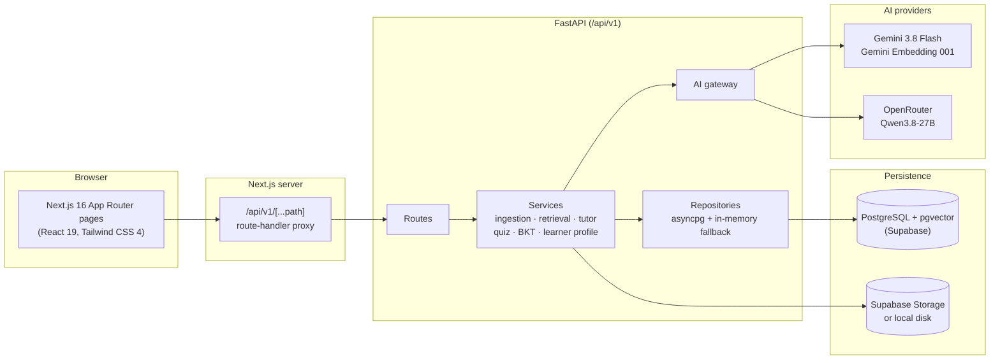
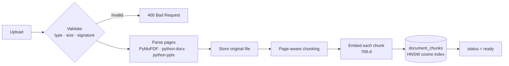
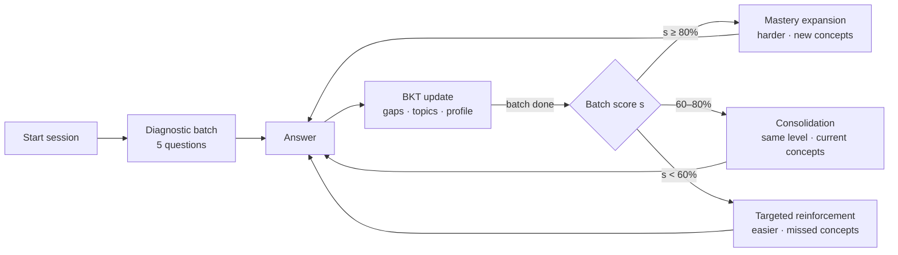

# LumoraAI architecture

This document describes how LumoraAI works as implemented in this repository. Parameter values are the ones in the code; file references point to where each piece lives.

- [System overview](#system-overview)
- [Accounts and data isolation](#accounts-and-data-isolation)
- [Document ingestion](#document-ingestion)
- [Retrieval and grounded tutoring](#retrieval-and-grounded-tutoring)
- [Learner model (Bayesian Knowledge Tracing)](#learner-model-bayesian-knowledge-tracing)
- [Adaptive quiz](#adaptive-quiz)
- [Question generation and quality checks](#question-generation-and-quality-checks)
- [Flashcards, study plan and activity](#flashcards-study-plan-and-activity)
- [AI provider gateway](#ai-provider-gateway)
- [Data model](#data-model)
- [Known limitations](#known-limitations)

## System overview



- The browser calls only relative `/api/v1/...` URLs. `app/api/v1/[...path]/route.ts` forwards them to the FastAPI server in `BACKEND_API_URL`. The timeout is 60 s, or 5 min for uploads.
- Every resource is scoped by `workspace_id`: documents, chunks, conversations, quiz sessions, mastery, flashcards, study plans and activity. Retrieval queries always filter by workspace, so subjects never mix.
- Each repository (`backend/app/repositories/`) uses PostgreSQL when `DATABASE_URL` is reachable and falls back to an in-process store otherwise. This is how the test suite runs without a database.
- Every request except `/health` and `/auth/*` must carry a valid session (see below).

## Accounts and data isolation

`backend/app/api/routes/auth.py`, `backend/app/api/deps.py`, `backend/app/core/security.py`, `proxy.ts`

- **Accounts.** `POST /auth/register` and `/auth/login` take an email and password. Passwords are hashed with PBKDF2-HMAC-SHA256 (600,000 iterations, per-user salt) and must have at least 8 characters with a letter and a number. Unknown emails and wrong passwords return the same error, and login is rate-limited to 10 attempts per 15 minutes per IP and email.
- **Sessions.** A successful login sets an HS256 JWT in an `httpOnly`, `SameSite=Lax` cookie (`Secure` in production) that lasts 7 days by default. API clients can send the same token as `Authorization: Bearer …`. `JWT_SECRET` is mandatory in production; the API refuses to start without it.
- **Isolation.** Each workspace has an `owner_id`. `require_workspace` loads the workspace from the path and returns **404** unless the caller owns it, so other users' workspace IDs are indistinguishable from missing ones. Document routes check the owner of the document's workspace, the workspace list and the global activity feed only include the caller's workspaces, and workspace IDs are generated by the server. Learner-model rows are keyed by workspace, so owning the workspace is what isolates them.
- **Email verification** (`repositories/auth_codes.py`, `services/email_service.py`). When an email provider is configured (`BREVO_API_KEY` or `SMTP_HOST`, plus `EMAIL_FROM_ADDRESS`), sign-up creates an unverified account and emails a 6-digit code; `POST /auth/verify-email` activates it and starts the session. Unverified accounts cannot sign in (they get a fresh code instead). Codes are stored as HMAC-SHA256 with the server secret, expire after 10 minutes, are single-use, lock after 5 wrong attempts, and can be re-sent once a minute (at most 5 per hour). Accounts created before migration 010, or while email is off, count as verified.
- **Password reset.** `POST /auth/forgot-password` always returns the same message (the email is sent after the response, so timing doesn't reveal accounts). `POST /auth/reset-password` checks the code, stores the new hash and sets `password_changed_at`. Session tokens carry a password-version claim derived from that timestamp, so a reset or a password change ends every older session. Account settings also allow renaming and deleting the account (which deletes all workspaces, stored files and learner data).
- **Frontend.** `proxy.ts` sends visitors without a session cookie from `/dashboard/*` to `/login?next=…`. The Next.js API proxy forwards the cookie to FastAPI and passes `Set-Cookie` back. Server Components call the API with the user's own token and never use the browser-side caches, so no user data is held in shared server memory. A 401 anywhere clears the cookie and returns to the sign-in page.

## Document ingestion

`POST /api/v1/workspaces/{id}/documents` (`backend/app/api/routes/documents.py`)



1. **Validation.** Accepted extensions are `.pdf`, `.docx`, `.pptx` and `.txt`, up to 10 MB. PDFs must start with `%PDF-` and DOCX/PPTX files must be ZIP containers; older `.doc`/`.ppt` files get a Save As message. Documents with no readable text even after OCR are rejected with 422.
   **Foreground or background.** Processing runs in a task. If it finishes within 20 seconds the request returns 201 with status `ready` (or the error); otherwise it returns **202** and the task continues, while the upload dialog and Sources page poll `GET /documents/{id}`. Background failures are stored as `failed` with a readable `error_message` and a notification. At start-up, uploads left in progress by a restart for over 10 minutes are marked failed.
   **OCR** (`services/ocr.py`). For PDFs, pages with fewer than 25 characters of extractable text are rendered at 150 dpi and transcribed by Gemini vision (3 at a time, at most 25 pages per document). Typed PDFs never use it.
2. **Parsing** (`services/document_parser.py`). Text is extracted per page or slide, with headings, section breadcrumbs, table markers and figure captions.
3. **Storage** (`services/storage.py`). The original file goes to the Supabase Storage bucket if configured, otherwise to `backend/data/documents/` (git-ignored). `GET /documents/{id}/view` and `/download` stream it back.
4. **Chunking** (`services/chunker.py`). Chunks target about 1,000 characters with 150 characters of overlap. They never cross a page boundary, and each chunk carries workspace, document, page, heading and chunk index metadata.
5. **Embedding** (`services/embeddings.py`). Chunks are embedded in batches of 100 with `models/gemini-embedding-001` (task type `retrieval_document`, 768 output dimensions, L2-normalised) and stored in `document_chunks.embedding vector(768)`. Failed batches are retried three times with back-off; if Gemini is still unavailable the upload fails with 503 and nothing is stored. Without a Gemini key, a deterministic offline embedder is used instead. Every chunk records the model that produced it in `metadata.embedding_model` (`gemini-embedding-001` or `offline-hash-v1`).

The document status moves `uploading → processing → extracting → indexing → ready` (or `failed`).

## Retrieval and grounded tutoring

`POST /api/v1/workspaces/{id}/tutor` (`services/query_understanding.py`, `services/retrieval.py`, `services/tutor.py`)

1. **Query understanding.** Each message is classified into an intent: `SPECIFIC_CONCEPT`, `CONTEXTUAL_FOLLOWUP`, `COMPARE_CONTRAST`, `DOCUMENT_SUMMARY`, `DOCUMENT_TOPIC_QUERY`, `PAGE_REFERENCE`, `PAGE_RANGE_REFERENCE`, `TABLE_QUERY`, `DIAGRAM_FIGURE_QUERY`, `WORKSPACE_METADATA` or `AMBIGUOUS_DOCUMENT`. Follow-ups such as "why is this important?" are resolved against the conversation history. A response mode is also detected: `standard`, `simplify`, `example`, `why_importance`, `compare`, `summary`, `exam_points`, `page_focus` or `page_range_focus`.
2. **Candidate retrieval.**
   - Page and page-range intents fetch those pages directly.
   - Summaries sample chunks across the document.
   - Comparisons retrieve each concept separately.
   - Otherwise, a **vector search** runs (pgvector cosine, top `max(2·k, 8)`, minimum similarity 0.35), followed by a **keyword search** that scores token matches in chunk text, headings and file names. The query is embedded once per embedding model present in the workspace and compared only with chunks from that model, so vectors from different models are never mixed. If a model's query embedding can't be produced (for example during a Gemini rate limit), that group relies on keyword matching.
3. **Fusion and reranking.** The base score is `max(vec, 0.65·vec + 0.35·lex)`. Bonuses are added for heading or file-name matches (up to +0.12), section matches (+0.05), a requested page (+0.25) or range (+0.20), and table or diagram intent (+0.20). A small diversity penalty (0.04 per earlier chunk from the same page) applies, near-duplicates are removed, and the top `k = 5` are kept.
4. **Grounding gate.** The tutor only answers when the best score reaches **τ = 0.50** (set in `RetrievalService`). The threshold is 0.52 when no keyword evidence exists and 0.35 for resolved follow-ups; page and summary intents are always answered. Otherwise it replies that the workspace sources do not cover the question.
5. **Generation.** The retrieved passages and recent history are sent through the AI gateway: Gemini first, OpenRouter on failure. If both are unavailable, the tutor builds a deterministic extractive answer from the passages, labelled `source_fallback`. Output is cleaned of prompt artefacts, and every answer returns citations (document, page, excerpt, score). Conversations are persisted.

## Learner model (Bayesian Knowledge Tracing)

`services/bkt_mastery.py`, `services/topic_mastery_engine.py`, `services/knowledge_gap_engine.py`

Each concept keeps a mastery probability `p = P(L)` with P(L₀) = 0.30, P(T) = 0.15, P(G) = 0.20 and P(S) = 0.10. After every answer:

```
correct:   P(L | C) = p(1 − S) / [ p(1 − S) + (1 − p)G ]
wrong:     P(L | W) = pS / [ pS + (1 − p)(1 − G) ]
next:      P(L') = P(L | obs) + (1 − P(L | obs)) · T
```

Values are clamped to [0.001, 0.999].

- **Concept bands:** mastered ≥ 0.75, proficient ≥ 0.45, otherwise needs review.
- **Topic mastery:** an evidence-weighted average of its concepts, with weight `log2(1 + attempts)`. A snapshot is stored after each update (`learner_mastery_snapshots`).
- **Knowledge gaps:** each concept gets a priority score:

  `0.35·(1 − p) + 0.25·recent error rate + 0.20·repeated errors + 0.10·difficulty struggle + 0.10·slow responses`

  It is then banded as strong (≤ 0.29), developing (≤ 0.49), needs attention (≤ 0.69) or critical gap, each with a recommended action.
- **Learner profile** (`GET /learner-profile`): overall mastery, strongest and weakest topics, top gaps, recent accuracy and response time, and recommendations. The workspace's overall mastery is synced after every answer.
- **Mastery history** (`GET /mastery/history?days=30`): for each day, the mean of every topic's latest mastery snapshot so far, carried forward on days without new answers. The analytics page plots it.

## Adaptive quiz

`services/quiz_service.py`, `services/adaptive_question_selector.py`



- A session serves batches of 5 questions, for up to 5 rounds. The first batch is a diagnostic drawn from the workspace's validated question bank when it has enough questions, and is generated otherwise.
- After each batch, the score selects the band above for the next one. Questions come from the bank, ranked by difficulty match and the band's concept rule, or are generated with the same target difficulty and concept order when the bank runs out.
- Correct answers are never sent to the browser. Answers are graded on the server, and question fingerprints prevent repeats within a session.

## Question generation and quality checks

`services/question_generator.py`, `services/question_quality_validator.py`

Candidate MCQs are generated from retrieved chunks by the AI gateway (the quiz task routes to OpenRouter first, then Gemini). A template-based synthesiser is used when no provider is available, and by the seed script. Every candidate must pass the validator before it is stored:

- exactly four options with no duplicates, no true/false options and no "all/none of the above" or "both A and B" options
- a known difficulty label (easy, medium or hard) and a non-empty concept tag
- the correct option is between 0.35× and 2.5× the average distractor length
- no answer leakage: verbatim answer in the stem, shared 4-grams, or > 50 % content-token overlap
- no file names or page references in the stem
- no raw code, tables or parser fragments
- no section headings used as answers
- concept names checked for generic prefixes
- rule-based check that the answer matches what the stem asks for (role, mechanism, …)
- SHA-256 fingerprint de-duplication

## Flashcards, study plan and activity

- **Flashcards** (`services/secondary_service.py`, `services/spaced_repetition.py`): if a workspace has fewer than six cards, up to ten are generated from cleaned passages spread across its documents: the AI provider writes a question and a 1–2 sentence answer grounded in one passage, and an extractive fallback turns definitional sentences into questions. Layout noise (card or question numbers, file names, page labels) is stripped first. Each Again / Hard / Good / Easy rating is saved through `POST /flashcards/{card_id}/review` and scheduled with SM-2: "again" makes the card due today and lowers its ease by 0.2; successful reviews are due after 1 day, then 6 days, then the previous interval × ease (× 1.2 for "hard", with a further × 1.3 for "easy"). The ease never drops below 1.3. Due cards are shown first.
- **Study plan:** rebuilt from the latest knowledge gaps and concept mastery each time it is opened or regenerated, so it follows quiz results. It counts down to the workspace's target completion date, which can't be set in the past (checked against the learner's local date, sent as `X-Client-Date`). Once the target date has passed, no plan is generated until the learner sets a new date (`PATCH /workspaces/{id}`). Active gaps become "Review & Remediate" tasks (the top two scheduled for today) and concepts at 50–80% mastery become practice tasks; with no quiz evidence yet it shows two starter tasks. Completed tasks and the minutes logged against the daily target are kept across rebuilds.
- **Search** (`services/search_service.py`, `GET /workspaces/{id}/search`): matches the query against the topic inventory, document titles, flashcards and (lexically) the indexed chunks, and returns grouped results with links; the header box opens with Ctrl/Cmd + K.
- **Notifications** (`services/notification_service.py`): stored per user in `notifications` with a `dedupe_key` so an event is recorded once. Created when a document is ready or fails, when a quiz finds weak topics (or none), once a day per workspace when flashcards are due, and on sign-up.
- **Activity:** document ingestion, quiz start and completion, and flashcard and study-plan generation are written to `activity_events` with UTC timestamps. The dashboard streak is computed from them.

## AI provider gateway

`backend/app/ai/gateway.py`

| Task | Primary | Fallback |
| :--- | :--- | :--- |
| Tutor answers | Gemini (`gemini-3.8-flash`) | OpenRouter (`qwen/qwen3.8-27b:free`) |
| Quiz / flashcard generation | OpenRouter | Gemini |

- A provider that returns HTTP 429 enters a cooldown and is skipped until it expires. `GET /health` reports backend, database and per-provider status separately.
- API keys are masked in logs and error messages (`ai/secret_masker.py`).
- The configured Gemini model is validated at start-up.

## Data model

Ten SQL migrations (`backend/app/db/migrations/`, applied by `python -m backend.app.cli migrate`, which records them in `schema_migrations`) create 20 tables:

| Area | Tables |
| :--- | :--- |
| Accounts | `users` (and `workspaces.owner_id`), `email_codes`, `notifications` |
| Content | `workspaces`, `documents`, `document_chunks` |
| Tutor | `tutor_conversations`, `tutor_messages` |
| Quiz | `quiz_sessions`, `quiz_questions`, `quiz_attempts`, `quiz_question_fingerprints`, `workspace_question_bank` |
| Learner model | `learner_concept_mastery`, `learner_knowledge_gaps`, `learner_topic_mastery`, `learner_mastery_snapshots` |
| Study tools | `flashcards`, `study_plans`, `activity_events` |

## Known limitations

- **Background processing is in-process.** Long uploads continue in the API process; if it restarts mid-upload, the document is marked failed and must be uploaded again. A durable job queue would remove that.
- **Rate limits are per process.** Login and code limits are kept in memory, which suits a single API instance; several instances would need a shared store such as Redis.
- **Template questions are weaker.** Without an AI provider, quiz questions come from a template synthesiser and can be generic or easy to guess. With a Gemini or OpenRouter key, questions are written by the LLM and pass the same checks.
- **Older SDK.** Gemini is called through `google-generativeai`, which Google has deprecated in favour of `google-genai`.
- **Fixed model configuration.** Start-up validation requires `gemini-3.8-flash` and `gemini-embedding-001`; changing models means updating that check.
