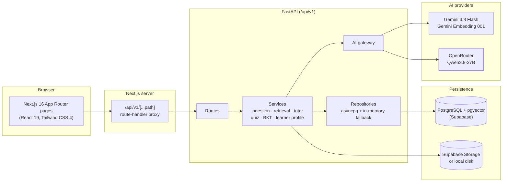
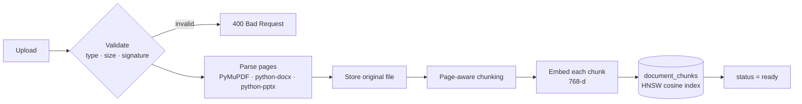
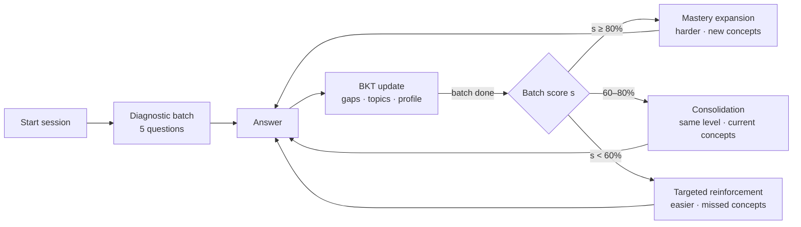

# LumoraAI architecture

This document describes how LumoraAI works as implemented in this repository. Parameter values are the ones in the code; file references point to where each piece lives.

- [System overview](#system-overview)
- [Document ingestion](#document-ingestion)
- [Retrieval and grounded tutoring](#retrieval-and-grounded-tutoring)
- [Learner model (Bayesian Knowledge Tracing)](#learner-model-bayesian-knowledge-tracing)
- [Adaptive quiz](#adaptive-quiz)
- [Question generation and quality checks](#question-generation-and-quality-checks)
- [Flashcards, study plan and activity](#flashcards-study-plan-and-activity)
- [AI provider gateway](#ai-provider-gateway)
- [Data model](#data-model)
- [Known limitations](#known-limitations)

## System overview



- The browser calls only relative `/api/v1/...` URLs. `app/api/v1/[...path]/route.ts` forwards them to the FastAPI server in `BACKEND_API_URL`. The timeout is 60 s, or 5 min for uploads.
- Every resource is scoped by `workspace_id`: documents, chunks, conversations, quiz sessions, mastery, flashcards, study plans and activity. Retrieval queries always filter by workspace, so subjects never mix.
- Each repository (`backend/app/repositories/`) uses PostgreSQL when `DATABASE_URL` is reachable and falls back to an in-process store otherwise. This is how the test suite runs without a database.
- Authentication is not implemented yet. The API acts on a single learner (`user_id = "default_user"`).

## Document ingestion

`POST /api/v1/workspaces/{id}/documents` (`backend/app/api/routes/documents.py`)



1. **Validation.** Accepted extensions are `.pdf`, `.docx`, `.pptx` and `.txt`, up to 10 MB. PDFs must start with `%PDF-`, and DOCX/PPTX files must be ZIP containers.
2. **Parsing** (`services/document_parser.py`). Text is extracted per page or slide, with headings, section breadcrumbs, table markers and figure captions.
3. **Storage** (`services/storage.py`). The original file goes to the Supabase Storage bucket if configured, otherwise to `backend/data/documents/` (git-ignored). `GET /documents/{id}/view` and `/download` stream it back.
4. **Chunking** (`services/chunker.py`). Chunks target about 1,000 characters with 150 characters of overlap. They never cross a page boundary, and each chunk carries workspace, document, page, heading and chunk index metadata.
5. **Embedding** (`services/embeddings.py`). `models/gemini-embedding-001` with task type `retrieval_document` (queries use `retrieval_query`). Vectors are truncated to 768 dimensions and L2-normalised, then stored in `document_chunks.embedding vector(768)`.

The document status moves `uploading → processing → extracting → indexing → ready` (or `failed`).

## Retrieval and grounded tutoring

`POST /api/v1/workspaces/{id}/tutor` (`services/query_understanding.py`, `services/retrieval.py`, `services/tutor.py`)

1. **Query understanding.** Each message is classified into an intent: `SPECIFIC_CONCEPT`, `CONTEXTUAL_FOLLOWUP`, `COMPARE_CONTRAST`, `DOCUMENT_SUMMARY`, `DOCUMENT_TOPIC_QUERY`, `PAGE_REFERENCE`, `PAGE_RANGE_REFERENCE`, `TABLE_QUERY`, `DIAGRAM_FIGURE_QUERY`, `WORKSPACE_METADATA` or `AMBIGUOUS_DOCUMENT`. Follow-ups such as "why is this important?" are resolved against the conversation history. A response mode is also detected: `standard`, `simplify`, `example`, `why_importance`, `compare`, `summary`, `exam_points`, `page_focus` or `page_range_focus`.
2. **Candidate retrieval.**
   - Page and page-range intents fetch those pages directly.
   - Summaries sample chunks across the document.
   - Comparisons retrieve each concept separately.
   - Otherwise, a **vector search** runs (pgvector cosine, top `max(2·k, 8)`, minimum similarity 0.35), followed by a **keyword search** that scores token matches in chunk text, headings and file names.
3. **Fusion and reranking.** The base score is `max(vec, 0.65·vec + 0.35·lex)`. Bonuses are added for heading or file-name matches (up to +0.12), section matches (+0.05), a requested page (+0.25) or range (+0.20), and table or diagram intent (+0.20). A small diversity penalty (0.04 per earlier chunk from the same page) applies, near-duplicates are removed, and the top `k = 5` are kept.
4. **Grounding gate.** The tutor only answers when the best score reaches **τ = 0.50** (set in `RetrievalService`). The threshold is 0.52 when no keyword evidence exists and 0.35 for resolved follow-ups; page and summary intents are always answered. Otherwise it replies that the workspace sources do not cover the question.
5. **Generation.** The retrieved passages and recent history are sent through the AI gateway: Gemini first, OpenRouter on failure. If both are unavailable, the tutor builds a deterministic extractive answer from the passages, labelled `source_fallback`. Output is cleaned of prompt artefacts, and every answer returns citations (document, page, excerpt, score). Conversations are persisted.

## Learner model (Bayesian Knowledge Tracing)

`services/bkt_mastery.py`, `services/topic_mastery_engine.py`, `services/knowledge_gap_engine.py`

Each concept keeps a mastery probability `p = P(L)` with P(L₀) = 0.30, P(T) = 0.15, P(G) = 0.20 and P(S) = 0.10. After every answer:

```
correct:   P(L | C) = p(1 − S) / [ p(1 − S) + (1 − p)G ]
wrong:     P(L | W) = pS / [ pS + (1 − p)(1 − G) ]
next:      P(L') = P(L | obs) + (1 − P(L | obs)) · T
```

Values are clamped to [0.001, 0.999].

- **Concept bands:** mastered ≥ 0.75, proficient ≥ 0.45, otherwise needs review.
- **Topic mastery:** an evidence-weighted average of its concepts, with weight `log2(1 + attempts)`. A snapshot is stored after each update (`learner_mastery_snapshots`).
- **Knowledge gaps:** each concept gets a priority score:

  `0.35·(1 − p) + 0.25·recent error rate + 0.20·repeated errors + 0.10·difficulty struggle + 0.10·slow responses`

  It is then banded as strong (≤ 0.29), developing (≤ 0.49), needs attention (≤ 0.69) or critical gap, each with a recommended action.
- **Learner profile** (`GET /learner-profile`): overall mastery, strongest and weakest topics, top gaps, recent accuracy and response time, and recommendations. The workspace's overall mastery is synced after every answer.

## Adaptive quiz

`services/quiz_service.py`, `services/adaptive_question_selector.py`



- A session serves batches of 5 questions, for up to 5 rounds. The first batch is a diagnostic drawn from the workspace's validated question bank when it has enough questions, and is generated otherwise.
- After each batch, the score selects the band above for the next one. Questions come from the bank, ranked by difficulty match and the band's concept rule, or are generated with the same target difficulty and concept order when the bank runs out.
- Correct answers are never sent to the browser. Answers are graded on the server, and question fingerprints prevent repeats within a session.

## Question generation and quality checks

`services/question_generator.py`, `services/question_quality_validator.py`

Candidate MCQs are generated from retrieved chunks by the AI gateway (the quiz task routes to OpenRouter first, then Gemini). A template-based synthesiser is used when no provider is available, and by the seed script. Every candidate must pass the validator before it is stored:

- exactly four options with no duplicates
- the correct option is between 0.35× and 2.5× the average distractor length
- no answer leakage: verbatim answer in the stem, shared 4-grams, or > 50 % content-token overlap
- no file names or page references in the stem
- no raw code, tables or parser fragments
- no section headings used as answers
- concept names checked for generic prefixes
- rule-based check that the answer matches what the stem asks for (role, mechanism, …)
- SHA-256 fingerprint de-duplication

## Flashcards, study plan and activity

- **Flashcards** (`services/secondary_service.py`): if a workspace has fewer than six cards, cards are built from the first chunks of its documents (heading → question, opening sentences → answer). Review ratings in the UI are not persisted yet.
- **Study plan:** tasks are generated from the learner's knowledge gaps and concept mastery, highest-priority gaps first, and can be toggled complete.
- **Activity:** document ingestion, quiz start and completion, and flashcard and study-plan generation are written to `activity_events` with UTC timestamps. The dashboard streak is computed from them.

## AI provider gateway

`backend/app/ai/gateway.py`

| Task | Primary | Fallback |
| :--- | :--- | :--- |
| Tutor answers | Gemini (`gemini-3.8-flash`) | OpenRouter (`qwen/qwen3.8-27b:free`) |
| Quiz / flashcard generation | OpenRouter | Gemini |

- A provider that returns HTTP 429 enters a cooldown and is skipped until it expires. `GET /health` reports backend, database and per-provider status separately.
- API keys are masked in logs and error messages (`ai/secret_masker.py`).
- The configured Gemini model is validated at start-up.

## Data model

Seven SQL migrations (`backend/app/db/migrations/`) create 17 tables:

| Area | Tables |
| :--- | :--- |
| Content | `workspaces`, `documents`, `document_chunks` |
| Tutor | `tutor_conversations`, `tutor_messages` |
| Quiz | `quiz_sessions`, `quiz_questions`, `quiz_attempts`, `quiz_question_fingerprints`, `workspace_question_bank` |
| Learner model | `learner_concept_mastery`, `learner_knowledge_gaps`, `learner_topic_mastery`, `learner_mastery_snapshots` |
| Study tools | `flashcards`, `study_plans`, `activity_events` |

## Known limitations

- **No authentication or multi-user support yet.** The login and register screens validate input only, and the API uses one default learner. Row-level security is not configured in Supabase.
- **Ingestion runs inside the upload request** and embeds chunks one at a time, so large documents take a while with a real embedding API.
- **Embedding fallback can mix vector spaces.** If an embedding call fails (for example on a rate limit), a deterministic offline vector is stored for that chunk, and those chunks are not marked.
- **Seeded workspaces use offline embeddings.** `scripts/reset_and_seed_real_workspaces.py` embeds chunks with the deterministic offline embedder. When `GEMINI_API_KEY` is set, questions are embedded with Gemini instead, so vector scores against those seeded chunks are not meaningful and retrieval relies on the keyword signal. Upload the documents through the app to index them with Gemini embeddings.
- **Template questions are weaker.** Questions from the template synthesiser (used offline and by the seed script) can be generic or awkward. LLM-generated questions are the intended path.
- **Not persisted yet:** flashcard review scheduling and notifications.
